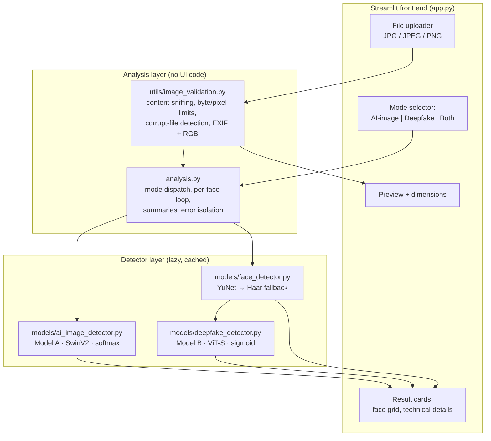
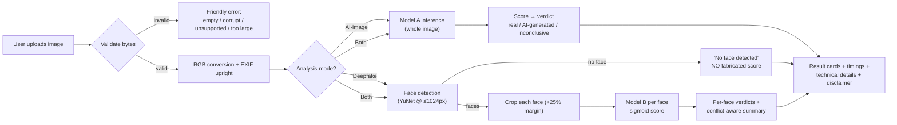

# VeriVision AI

**Real Image, AI-Generated Image & Deepfake Face Detection** — a college-level
Streamlit application that runs *actual machine-learning inference* on images
you upload, with two independent detectors and honestly qualified results.

> ⚠️ **Disclaimer.** All predictions are probabilistic model outputs with
> uncalibrated scores. They are **not proof of authenticity**. Do not use the
> results to accuse, defame or judge any person or organisation. The system
> does not identify individuals and cannot determine who created or edited an
> image.

---

## 1. Problem statement

Generative models can now synthesise photorealistic images and swap or
reenact faces convincingly. Verifiers (journalists, teachers, students,
moderators) need tooling that answers a narrower, answerable question: *"does
specialised software find evidence that this image is synthetic or
manipulated?"* — with full transparency about what the software can and
cannot know.

## 2. Objectives and scope

| In scope | Out of scope |
|---|---|
| Whole-image AI-generation detection (Model A) | Video analysis (single images only) |
| Per-face manipulation detection (Model B) | Person identification / attribution |
| Face detection + cropping + multi-face summaries | Calibrated probabilities (models ship uncalibrated) |
| Transparent scores, uncertainty band, limitations | Legal-grade image forensics (ELA, sensor noise, metadata chains) |
| CPU inference on Windows 11 & macOS (CUDA/MPS acceleration used when available) | Training new detectors from scratch |

## 3. System architecture





**Runtime data flow.** Model weights are downloaded once into
`.model_cache/` (git-ignored; override with `VERIVISION_MODEL_CACHE` or
`HF_HOME`) and loaded lazily — only the models the selected mode needs are
ever materialised in memory, and Streamlit's `@st.cache_resource` keeps them
loaded across reruns.

> Presentation-ready PNG versions of both diagrams are in
> `docs/architecture.png` and `docs/workflow.png` (sources:
> `docs/architecture.mmd`, `docs/workflow.mmd` — re-render with the Mermaid
> CLI: `mmdc -i docs/architecture.mmd -o docs/architecture.png`).

## 4. Model selection rationale

Both models were **verified against the live Hugging Face registry** and then
**empirically compared** on real + AI-generated samples during development.
Nothing here is invented; every candidate below was actually downloaded and
run.

### Model A — AI-generated image detection (whole image)

**Selected: [`haywoodsloan/ai-image-detector-deploy`](https://huggingface.co/haywoodsloan/ai-image-detector-deploy)**
· SwinV2 · 256×256 · Apache-2.0 · id2label `{0: 'artificial', 1: 'real'}`
(softmax; fake class = index 0, validated at every load).

Published validation metrics (model card, in-domain): accuracy 0.981, F1
0.988, AUC 0.995. The AutoTrain card does not disclose the training dataset —
a limitation we accept and document.

Measured by this project (CPU, during development, 5 samples):

| Sample | Ground truth | Score (artificial) | Result |
|---|---|---|---|
| real landscape | real | 0.018 | ✅ real |
| real portrait | real | 0.024 | ✅ real |
| AI mountain lake | AI | 0.992 | ✅ AI |
| AI portrait | AI | 1.000 | ✅ AI |
| AI food plate | AI | 0.998 | ✅ AI |

Candidates evaluated and **rejected** (all actually run on the same samples):

| Candidate | Reason for rejection |
|---|---|
| `dima806/ai_vs_human_generated_image_detection` | Missed 2 of 3 modern AI images (its own card warns of concept drift) |
| `Ateeqq/ai-vs-human-image-detector` | Missed 2 of 3 AI images |
| `Organika/sdxl-detector` | False positive on a real photo **and** CC-BY-NC (non-commercial) |
| `umm-maybe/AI-image-detector` | Author marks it deprecated for post-2022 generators |

### Model B — deepfake face detection (per face crop)

**Selected: [`buildborderless/CommunityForensics-DeepfakeDet-ViT`](https://huggingface.co/buildborderless/CommunityForensics-DeepfakeDet-ViT)**
· ViT-S/16 · 384×384 (shortest-edge 440 + centre crop) · MIT · trained on
2.7M samples across 4,803 generators · output is a **single sigmoid logit
where 1.0 = fake** (semantics defined by the model card; the loader verifies
the one-logit structure at load time). Based on the paper *"Community
Forensics: Using Thousands of Generators to Train Fake Image Detectors"*
(arXiv:2411.04125).

Candidates evaluated and **rejected**:

| Candidate | Reason for rejection |
|---|---|
| `dima806/deepfake_vs_real_image_detection` | Despite 53k downloads, it scored **all 6 real web-portrait crops as fake (0.55–0.99)** — a systematic false-positive problem we measured directly |
| `prithivMLmods/Deep-Fake-Detector-v2-Model` | Mixed: 2/5 real faces correct, 2 false positives |
| `KoreaPeter/ms-eff-gcvit-*` | Video-classification pipeline, not image-level inference |

Face detection uses **OpenCV YuNet** (Apache-2.0 ONNX model, downloaded by
`scripts/download_models.py`) with automatic fallback to OpenCV's bundled
Haar cascade when the weights are absent, so the app works fully offline.
Detection runs on a copy downscaled to ≤1024 px on the long side (boxes are
scaled back) — measured to remove background false positives on
high-resolution photos.

### Key engineering findings (measured, not assumed)

1. **Label mappings are a trap.** The two softmax checkpoints we compared use
   *opposite* fake-class indices. The loader therefore validates the mapping
   strictly and fails loudly instead of silently inverting real/fake.
2. **Popular ≠ correct.** The most-downloaded deepfake checkpoint had a ~100%
   false-positive rate on our real faces; empirical validation changed the
   selection.
3. **Detection scale matters.** YuNet at full resolution on a 3000×4509 photo
   produced 3 background false positives; at ≤1024 px it found exactly the
   true face.

## 5. Datasets

This project ships **no dataset**. For evaluation you provide labelled
folders (see §8). Relevant public datasets and their access restrictions:

- **GenImage** (Zhu et al., NeurIPS 2023 D&B) — 1.3M images, real vs
  Midjourney/Stable Diffusion/etc. Request access from the authors.
- **FaceForensics++** (Rossler et al., CVPR 2019) — requires signing an
  agreement on the official site; weights/data must not be redistributed.
- **Celeb-DF v2** (Li et al., CVPR 2020) — academic request form.
- **DeepfakeTIMIT** — request form.

Never mix near-duplicates or frames of the same source video across the
`real`/`fake` folders — that inflates metrics (see §8).

---

## 6. Installation

### 6.1 Windows 11 (PowerShell)

```powershell
# 1) Install Python 3.11 or 3.12 from python.org (tick "Add to PATH").
py -3.11 --version        # verify the launcher sees it

# 2) Open PowerShell in your projects folder, e.g.:
cd C:\Users\<you>\Projects

# 3) Get the project (unzip the download, or git clone), then:
cd verivision-ai

# 4) Create and activate a virtual environment
py -3.11 -m venv .venv
.\.venv\Scripts\Activate.ps1
```

> **PowerShell blocks activation?** (`running scripts is disabled`) Do **not**
> weaken your machine-wide policy. Either allow it for this session only —
> `Set-ExecutionPolicy -Scope Process -ExecutionPolicy Bypass` — then
> re-run `.\.venv\Scripts\Activate.ps1`; or skip activation entirely and call
> the venv's interpreter directly:
> `.\.venv\Scripts\python.exe -m streamlit run app.py`

```powershell
# 5) Install dependencies
python -m pip install --upgrade pip
pip install -r requirements.txt

# 6) (Recommended) pre-download model weights (~0.9 GB, one time)
python scripts/download_models.py

# 7) Start the application
python -m streamlit run app.py
```

The terminal shows a local URL — normally **http://localhost:8501**.

### 6.2 macOS (Apple Silicon M1–M4 and Intel)

```bash
# 1) Verify tools (Xcode CLT provides python3; or install Python from
#    python.org). Homebrew is NOT required.
python3 --version          # 3.11 or 3.12 recommended
python3 -m pip --version

# 2) Navigate to the project (replace with YOUR folder path)
cd /path/to/verivision-ai

# 3) Create and activate a virtual environment
python3 -m venv .venv
source .venv/bin/activate

# 4) Install dependencies
python -m pip install --upgrade pip
python -m pip install -r requirements.txt

# 5) (Recommended) pre-download model weights (~0.9 GB, one time)
python scripts/download_models.py

# 6) Start the application
python -m streamlit run app.py
```

Open **http://localhost:8501**. On Apple Silicon the app automatically uses
the PyTorch **MPS** backend when available and transparently falls back to
CPU for any unsupported op. Intel Macs run on CPU.

### 6.3 Run the tests

```powershell
python -m pytest tests -v          # Windows
```
```bash
python3 -m pytest tests -v         # macOS / Linux
```

## 7. Running the application

1. Choose an analysis mode in the sidebar: **AI-Generated Image Detection**,
   **Deepfake Face Detection**, or **Both Detectors**.
2. Upload a JPG/JPEG/PNG (validated by *content*, not extension).
3. Press **🔬 Analyze Image**. First run downloads weights once
   (~0.9 GB); later runs load from the local cache.
4. Read the verdict cards:
   - *Likely real photograph* / *Likely AI-generated image* /
     *Likely manipulated / deepfake* / **Inconclusive**
   - Every score is shown with a description of what it does **not** mean.
5. In deepfake mode: bounding boxes are drawn on the preview, each detected
   face gets its own verdict card, and multi-face images get a conflict-aware
   summary (disagreement is surfaced, never averaged away).
6. Press **🔄 Analyze another image** to reset.

If **no face** is found, the deepfake detector reports *No face detected*
and explicitly produces **no score** — it is never asked about face-free
images, and the AI-image detector is a separate model entirely (a "real"
verdict from Model A is **not** evidence that a face is unmanipulated, and
vice versa).

## 8. How inference works

**Preprocessing (both detectors).** Bytes are sniffed for true format
(JPEG/PNG only), integrity-checked, EXIF-rotated, alpha-composited onto white
and converted to RGB. Model-specific resize/normalisation is done by each
checkpoint's own HF image processor (Model A: 256×256 SwinV2; Model B:
shortest-edge 440 → centre-crop 384, CLIP normalisation).

**Model A (whole image).** Softmax over `{artificial, real}`; the reported
score is the `artificial` probability.

**Model B (per face).** Faces are detected on a ≤1024 px copy (YuNet,
score ≥ 0.6), scaled back to original coordinates, filtered to ≥ 64 px, then
each face is cropped with a 25% margin and scored by the sigmoid logit.

**Decision rule — documented, not invented.** `0.5` is the *argmax boundary*
of a two-class softmax (and of the sigmoid), **not** a calibrated threshold.
Scores within **±0.10** of 0.5 are reported as **Inconclusive**. That band is
a conservative *interface heuristic* chosen so borderline inputs are
surfaced rather than forced binary — it is **not** a validated calibration
procedure, and no number in the UI is a probability of ground truth. All
constants live in `config.py`.

**Failure behaviour.** Missing weights / no network → actionable error with
fix commands; a failing accelerator op → automatic CPU retry (visible as a
warning); a face that errors → that face shows "Analysis error" without
poisoning the others; a missing model **never** falls back to a dummy
predictor.

## 9. Evaluation methodology & measured results

`scripts/evaluate.py` measures **this project's own** numbers on folders you
provide:

```bash
python scripts/evaluate.py --detector ai-image \
    --real-dir data/eval/real --fake-dir data/eval/ai --limit 100 \
    --output docs/measured_ai_image_eval.json
```

It reports accuracy, precision/recall/F1 (fake = positive class), the
confusion matrix and ROC-AUC at the 0.5 boundary, plus per-file predictions
and a separate count of skipped (face-free) images. **Published benchmark
numbers and numbers measured by this project are kept separate throughout
this README.**

### Measured by this project — demo evaluation (tiny, honest)

Dataset: 10 images for Model A (5 real web photos, 5 AI-generated by a modern
diffusion generator) and 7 face crops for Model B (5 real faces, 2 synthetic
faces). CPU. JSON reports with per-file predictions are committed under
`docs/measured_*_eval.json`. **These are demos of the measurement workflow,
not benchmarks** — n is far too small for significance.

| Detector | n | Accuracy | Precision (fake) | Recall (fake) | ROC-AUC |
|---|---|---|---|---|---|
| Model A (AI-image) | 10 | 0.90 | 1.00 | 0.80 | 0.84 |
| Model B (deepfake) | 7 | 0.43 | 0.00 | 0.00 | 0.40 |

Interpretation, stated plainly:

- Model A handled this tiny modern-generator sample well (1 miss, 0 false
  alarms) — consistent with its published in-domain metrics but **not**
  proof of generalisation.
- Model B **missed both synthetic faces** from the unseen generator (scores
  0.001 / 0.044) and produced 2 false positives on stylised real portraits
  (0.997 / 1.000). Per-file scores also show **crop-boundary sensitivity**:
  the same face scored 0.003 with one crop and 1.000 with a slightly
  different crop. Treat deepfake-mode output as one weak signal among
  several, never as a verdict.

For real evaluation: build a held-out set of ≥500 images per class spanning
multiple generators, manipulation types, JPEG qualities and resolutions,
keeping near-duplicates within one split only.

## 10. Testing

`python -m pytest tests -v` — 49 automated tests, all passing at release
time. Mocked model outputs are used **only** inside `tests/`; the app itself
never substitutes a dummy predictor.

| Requirement (spec §10) | Covered by |
|---|---|
| Valid JPEG / PNG uploads | `test_validation.py` |
| Corrupt / truncated files | `test_validation.py` |
| Unsupported formats (BMP, text-renamed-PNG) | `test_validation.py` |
| Very large images (bytes + pixels) | `test_validation.py` |
| Missing model weights | `test_detectors.py` |
| Network download failure | `test_detectors.py` |
| Inference exceptions | `test_detectors.py` |
| Model label mapping (+ sigmoid structure) | `test_detectors.py`, `test_results.py` |
| Uncertain predictions (band) | `test_results.py` |
| Images with no faces (no fabricated score) | `test_face_detection.py` |
| Multiple faces / conflicting predictions | `test_face_detection.py` |
| Both-detector mode independence | `test_detectors.py` |
| CPU-only execution | everything above ran CPU-only |

## 11. Project structure

```
verivision-ai/
├── app.py                     # Streamlit UI
├── analysis.py                # pure orchestration (mode dispatch, per-face loop)
├── config.py                  # all constants, model IDs, decision rule
├── conftest.py                # shared fixtures (mock detectors live ONLY here/tests)
├── pytest.ini
├── requirements.txt           # pinned versions verified on Python 3.12
├── .gitignore                 # excludes .model_cache/, data/, venvs
├── models/
│   ├── common.py              # device pick, guarded loading, label validation, inference
│   ├── ai_image_detector.py   # Model A wrapper
│   ├── deepfake_detector.py   # Model B wrapper
│   └── face_detector.py       # YuNet → Haar, downscale detect, crops, box drawing
├── utils/
│   ├── image_validation.py    # content-sniffing validation, typed errors
│   ├── preprocessing.py       # EXIF, RGB conversion, stats
│   └── result_formatting.py   # verdict mapping, band, summaries, score text
├── scripts/
│   ├── download_models.py     # pre-fetch weights for offline use
│   ├── evaluate.py            # measured metrics on your labelled folders
│   └── smoke_test.py          # real-inference end-to-end check
├── tests/                     # 49 pytest cases (see §10)
├── assets/sample_images/      # bundled demo images (see provenance note below)
├── docs/                      # measured evaluation JSON + diagrams
└── .model_cache/              # created at runtime, git-ignored (weights live here)
```

**Sample-image provenance.** `assets/sample_images/` contains real photos
retrieved from the public web (photography sites / Unsplash) and images
generated with a diffusion model during development. They are included for
local demonstration only — replace them before any redistribution.

## 12. Limitations

- **Uncalibrated scores.** No calibration set was used; scores are model
  outputs, not probabilities of truth (§8).
- **Concept drift.** Detectors age as generators evolve; Model B missed both
  synthetic faces from a novel generator in our demo eval.
- **Domain shift.** Model B showed false positives on stylised professional
  portraits and **crop-boundary sensitivity** (§9).
- **Whole-image vs face tasks.** A "real" from Model A says nothing about
  face manipulation; a "real" from Model B says nothing about whole-image
  synthesis. This is why the modes are separate and results are never merged.
- **Face constraints.** Heavy occlusion, extreme angles, very small faces and
  face-free images are unsupported for deepfake mode (reported, not guessed).
- **No explanation maps.** Neither checkpoint ships a validated explanation
  method; the app deliberately generates **no** attention/heat-map overlays
  because such maps would be decorative, not evidence.
- **No metadata forensics.** EXIF orientation is applied for display, but
  EXIF/C2PA provenance is not analysed.
- Single images only; no video, no batch mode, no person identification.

## 13. Ethical considerations

- **False accusations are the worst failure.** Every UI label, colour and
  text is chosen so "likely real" cannot be read as "authentic", and
  "likely fake" cannot be read as "forged". The inconclusive band exists to
  absorb ambiguity rather than push users to a binary.
- **Privacy.** Uploaded images are processed locally; nothing is sent to any
  server beyond the one-time Hugging Face model download. No telemetry.
- **Bias.** Detector training data skews toward certain demographics and
  photography styles; error rates may differ across skin tones, ages and
  image sources. Do not draw conclusions about individuals.
- **No attribution.** The system never infers *who* made or manipulated an
  image — that claim would require provenance data, not a classifier.
- **Intended use:** education and awareness. Not legal, journalistic or
  forensic evidence.

## 14. Troubleshooting

| Symptom | Fix |
|---|---|
| `python3: command not found` (macOS) | Install Python 3.11/3.12 from python.org; on fresh shells `xcode-select --install` provides a stub. |
| `py -3.11` not found (Windows) | Reinstall Python from python.org and enable the `py` launcher; use `where python` to inspect PATH conflicts. |
| Activation blocked (PowerShell) | `Set-ExecutionPolicy -Scope Process Bypass` (session only) or use `\.venv\Scripts\python.exe -m ...` directly. |
| Weights download fails / HF blocked | `python scripts/download_models.py`; set a mirror: `$env:HF_ENDPOINT="https://hf-mirror.com"` (Windows) / `export HF_ENDPOINT=https://hf-mirror.com` (macOS/Linux); verify proxy/firewall. |
| Weights already downloaded but app says missing | Check the path shown in the sidebar ("Weights location"); it must contain `.model_cache/`. Set `VERIVISION_MODEL_CACHE` if you moved it. |
| `torch` install errors | Use Python 3.11/3.12; CPU wheels: `pip install torch torchvision --index-url https://download.pytorch.org/whl/cpu`. |
| Apple Silicon **MPS** errors | The app retries on CPU automatically; to force CPU: `export VERIVISION_FORCE_CPU=1` is not needed — errors are already handled; report persistent MPS failures as an issue. |
| Out of memory / slow | Close other apps (Model A needs ~1 GB RAM); analyse one mode at a time; smaller images are fine (they are resized per model spec). |
| Streamlit port already in use | `python -m streamlit run app.py --server.port 8502`. |
| `opencv` import error | `pip install opencv-python-headless==4.13.0.90` inside the venv. |
| Version conflicts | Recreate the venv (`deactivate`, delete `.venv/`, repeat §6) — `requirements.txt` pins are mutually verified. |

## 15. Cross-platform verification status (honest)

| Item | Status |
|---|---|
| Development/test OS used for this build | Linux x86_64 (container), Python 3.12.15 |
| Framework versions tested | torch 2.14.1+cpu, torchvision 0.29.1+cpu, transformers 5.19.0, streamlit 1.65.0, opencv-headless 4.13.0.90, pillow 11.3.0, numpy 2.1.3 |
| Model downloads from Hugging Face | ✅ succeeded (both checkpoints + YuNet) |
| CPU inference | ✅ verified end-to-end (smoke test + demo eval) |
| Automated tests | ✅ 49/49 passed on the build machine |
| Windows 11 run | ❔ **not executed here** — instructions follow official Python/Streamlit docs; code uses `pathlib` + relative paths and no OS-specific shell calls |
| macOS run / Apple Silicon MPS | ❔ **not executed here** — MPS is selected automatically when available with CPU fallback (unit-tested); CPU remains the reliable baseline |
| CUDA | not required; used automatically if present |

## 16. Demonstration guide (5 minutes)

1. `python -m streamlit run app.py` → open http://localhost:8501.
2. Upload `assets/sample_images/sample_ai_scene.jpg` in **Both Detectors**
   mode → AI-image card: *Likely AI-generated* (≈0.99); deepfake card: *No
   face detected* with no score.
3. Upload `assets/sample_images/sample_real_portrait.jpg` → AI-image:
   *Likely real* (≈0.02); deepfake: 1 face, *Likely real* (≈0.004), box drawn
   on the preview.
4. Upload `assets/sample_images/sample_ai_portrait.jpg` → AI-image:
   *Likely AI-generated* (≈1.00); deepfake: the synthetic face scores low
   (novel generator — the documented miss from §9) — an ideal talking point
   about complementary detectors.
5. Try a BMP or a renamed text file → friendly validation errors.
6. Run `python -m pytest tests -v` and `python scripts/smoke_test.py`.

## 17. References

1. haywoodsloan, *ai-image-detector-deploy*, Hugging Face model card, 2023–2024. https://huggingface.co/haywoodsloan/ai-image-detector-deploy
2. buildborderless, *CommunityForensics-DeepfakeDet-ViT*, Hugging Face model card, 2026. https://huggingface.co/buildborderless/CommunityForensics-DeepfakeDet-ViT
3. Y. Qiu, W. Wang, J. M. Jose, O. J. Wang, K. Zhang, R. Yang, W. Lu, S.-N. Lim. *Community Forensics: Using Thousands of Generators to Train Fake Image Detectors.* arXiv:2411.04125, 2024.
4. M. Zhu, H. Chang, A. Nyberg, S. Shan. *GenImage: A Million-Scale Benchmark for Detecting AI-Generated Image.* NeurIPS Datasets & Benchmarks, 2023.
5. A. Rossler, D. Cozzolino, L. Verdoliva, C. Riess, J. Thies, M. Nießner. *FaceForensics++: Learning to Detect Manipulated Facial Images.* CVPR, 2019.
6. Y. Li, X. Yang, P. Sun, H. Qi, S. Lyu. *Celeb-DF: A Large-scale Challenging Dataset for DeepFake Forensics.* CVPR, 2020.
7. J. Wang, Z. Wu, W. Ouyang, X. Han, J.-Y. Zhu, S. N. Lim. *CNN-FakeDetect / Universal Fake Detection* ("Seeing is not believing"), CVPR, 2020 (CNNSpot/UniversalFakeDetect).
8. A. Dosovitskiy et al. *An Image is Worth 16x16 Words: Transformers for Image Recognition at Scale.* ICLR, 2021.
9. OpenCV Zoo — *YuNet face detection* (Apache-2.0). https://github.com/opencv/opencv_zoo/tree/main/models/face_detection_yunet
10. Streamlit documentation. https://docs.streamlit.io · Hugging Face Transformers documentation. https://huggingface.co/docs/transformers

### Third-party licences

| Component | Licence |
|---|---|
| Model A checkpoint (`haywoodsloan/ai-image-detector-deploy`) | Apache-2.0 |
| Model B checkpoint (`buildborderless/CommunityForensics-DeepfakeDet-ViT`) | MIT |
| YuNet face-detection ONNX (opencv_zoo) | Apache-2.0 |
| PyTorch / Transformers / Streamlit / OpenCV / Pillow / scikit-learn | BSD / Apache-2.0 / MIT family |

Project code is provided for educational purposes under the MIT Licence
(see `LICENSE`).

